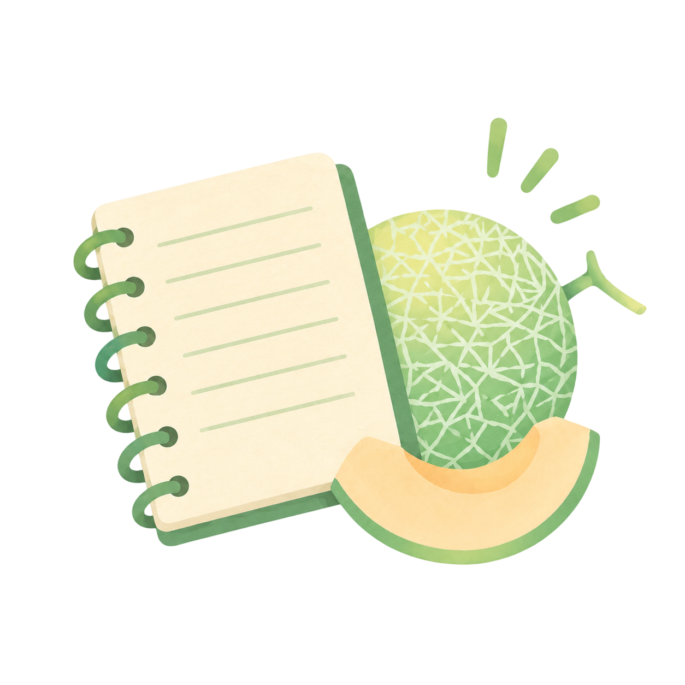
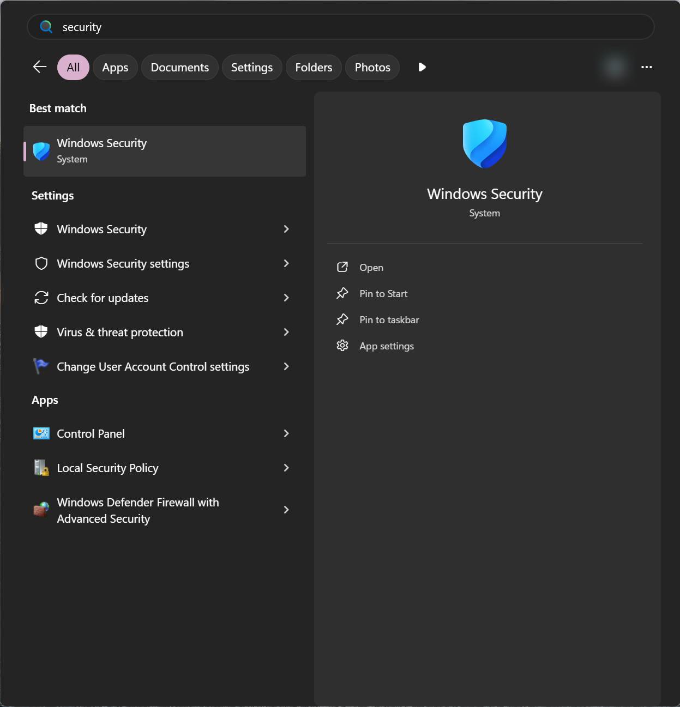
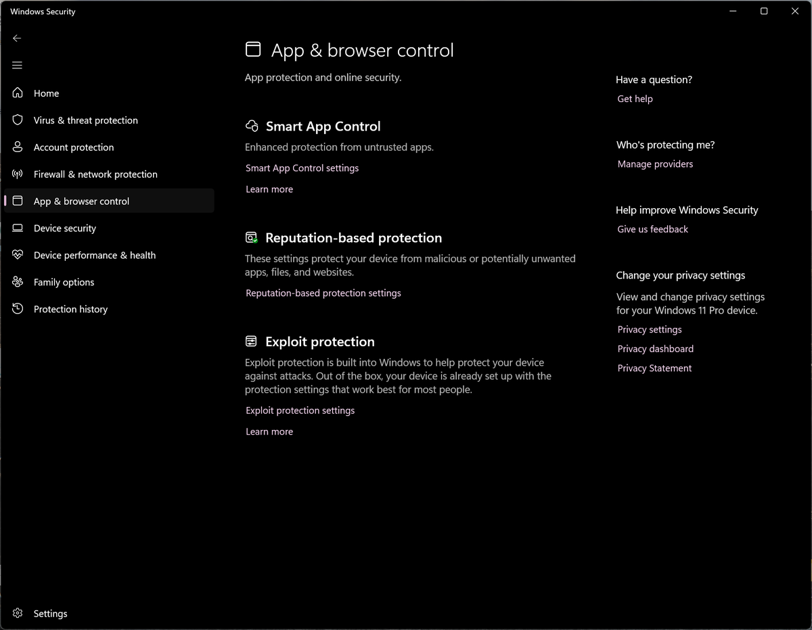
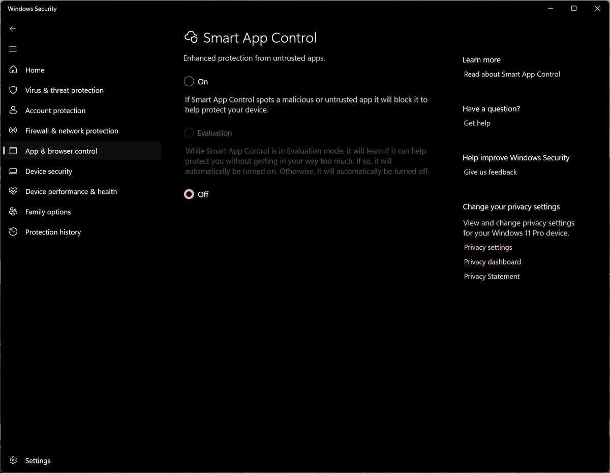

<p align="center">
  
</p>

<h1 align="center">PaperNotes</h1>

<p align="center">
  A study app for Windows. Your notes, slides and past papers in one place, with the tools to actually study them.<br>
  <b><a href="https://github.com/MilkmanAbi/PaperNotes/releases/latest">Download the latest version</a></b> &nbsp;·&nbsp; Windows 10 and 11, 64-bit &nbsp;·&nbsp; free and open source (GPLv3)
</p>

<p align="center">(｀・ω・´)ゞ</p>

---

PaperNotes opens a folder of your school stuff (Markdown notes, PDFs, slides, past papers, anything) and turns it into a place to study. It never moves or converts your files: they stay ordinary files in a folder you pick, so you can still open them anywhere, sync them with OneDrive, or back them up however you like.

I built it for my own semester and then it got a bit out of hand. Now it's yours too ヽ(・∀・)ﾉ

## What it does

**Reading and finding things**
- A file tree that copes with huge, deeply nested folders, plus tabs (each with its own back and forward), side-by-side panes and an outline.
- Search across names and the text inside your notes, PDFs and slides. `Ctrl K` jumps to anything or runs any command.
- Notes render properly: LaTeX maths (KaTeX) and chemistry (`\ce{H2O}`), Mermaid diagrams, code with highlighting, code blocks you can run, `[[links between notes]]`, callouts.
- A real editor (CodeMirror) with line numbers and search, for when you write your own notes.

**Studying**
- Mark notes as done and watch folders fill up. Colour tags. Reminders that pop up as Windows notifications.
- Confused about something? Click the red dot next to it. Those spots are collected so you (or Claude) can go back over them.
- Sticky notes that stay pinned to the paragraph you stuck them on.
- Flashcards with spaced repetition: the hard ones come back sooner, the easy ones drift away.
- Right-click any text: turn it into a flashcard or a sticky, set a reminder, drop it in your Inbox, search Google, YouTube or Wikipedia, have it read aloud, or ask Claude to explain it, simplify it or quiz you on it.
- A Pomodoro timer in the status bar: study, break, rounds, pause and resume.
- Study time that only counts real studying (scrolling, reading, typing), a year of study days in a GitHub-style graph, streaks and some badges of questionable dignity.

**You**
- A profile with your picture, your school details and anything you want Claude to know about how you learn.
- Your semester week (Wk 1, Wk 2 and so on) and today's classes from a `timetable.csv`.

**Comfort**
- 15 themes, each in light and dark: Paper, Sakura, Ocean, Deep Ocean, Darker, Gruvbox, Solarized, Nord, Dracula, Catppuccin, Tokyo Night, Rose Pine, Everforest, Kanagawa and One.
- A music player for your Music folder, with proper titles, artists and cover art in any language, and Windows' media keys.
- Relax mode: the tab becomes a calm animation (bring your own video if you like). Put some music on and go lie down for a bit (￣ー￣)
- T^T. It's a button. Press it when studying has gone wrong.

**Claude (optional)**
- If you use [Claude Code](https://claude.com/claude-code), PaperNotes opens it right next to your note, already told who you are, what you're reading, where you're confused and what's due.
- PaperNotes also includes tools for Claude (an MCP server), so Claude can read your notes, make flashcards, add reminders and stickies, and plan your week. Settings, then Claude, then Connect.
- None of this is needed to use PaperNotes. Everything above works without it.

**Looking after your stuff**
- A backup every day of every note you can edit and everything PaperNotes remembers, kept for 14 days, restorable one file at a time.
- It can start with Windows and sit quietly in the notification area, so reminders still reach you.

## Install

1. Download **PaperNotes-Setup-x.y.z.exe** from the [latest release](https://github.com/MilkmanAbi/PaperNotes/releases/latest).
2. Run it. It installs just for you (no admin needed) into `%LOCALAPPDATA%\Programs\PaperNotes`.
3. On first start, pick the folder with your notes, or let PaperNotes create a new library in `Documents\PaperNotes`.

### "Windows protected your PC"

PaperNotes isn't signed with a paid code-signing certificate (it's a student project (；´∀｀)), so Windows doesn't recognise it and may warn you the first time. That's normal for small open-source apps.

- **If you see a blue "Windows protected your PC" box** (that's SmartScreen): click **More info**, then **Run anyway**. You only need to do this once.
- **If Windows blocks it outright** with no Run anyway button, that's **Smart App Control**, which blocks every app that isn't signed. You can turn it off:

  1. Open Start, search for **Windows Security** and open it.

     

  2. Go to **App & browser control**, then click **Smart App Control settings**.

     

  3. Choose **Off**.

     

  Then run the installer again.

> [!WARNING]
> On many versions of Windows, once Smart App Control is turned off it can't be turned back on without resetting Windows. Your other protection (Microsoft Defender antivirus, SmartScreen, the firewall) keeps working either way. If you'd rather not, you can build PaperNotes yourself instead (see below).

You can always check what you're running: every release is built in the open by [GitHub Actions](.github/workflows/release.yml) from the code in this repository, and GitHub shows each installer's SHA-256 on the release page.

## Updating

PaperNotes 2.3 and later update themselves. A few seconds after it starts (and twice a day while it runs) PaperNotes quietly checks this repository's [releases](https://github.com/MilkmanAbi/PaperNotes/releases). When there's a newer version, an **Update** button appears at the top. Click it and PaperNotes:

1. saves everything that isn't on disk yet (the note you're editing, your tabs, settings and study data),
2. downloads the new installer and checks it's exactly the file on the release page (its size and SHA-256),
3. closes, installs the new version over the old one, and opens again.

Only the program is replaced. Your notes, your settings, your profile picture, your study history and the app's caches are left exactly as they are. Nothing is ever installed without your click, and you can turn the checking off in Settings, then About. Versions follow [semver](https://semver.org), and drafts and pre-releases are never offered.

You can also just download a newer installer and run it over the old version: it upgrades in place the same way.

## Where your things live

| What | Where |
|---|---|
| Your notes | The folder you chose (by default `Documents\PaperNotes`). PaperNotes never moves or rewrites your files unless you edit them in it. |
| What PaperNotes remembers (done, tags, reminders, stickies, flashcards, study time, your picture, a copy of your settings, the search text of your PDFs, backups) | A hidden `.papernotes` folder inside your notes folder, so it travels with your notes. |
| Your details | `info.md` and `timetable.csv` at the top of your notes folder (they don't show in the tree). Edit them from your Profile. |
| The program | `%LOCALAPPDATA%\Programs\PaperNotes` |
| Caches (the app's browser data) | `%LOCALAPPDATA%\PaperNotes` |
| A few settings (which folder, music folder, start with Windows) | The registry, under `HKEY_CURRENT_USER\Software\PaperNotes` |

PaperNotes doesn't send your notes anywhere. The only things it reaches out to on its own are GitHub, to check for updates, and the search and help sites you choose from a menu.

**Uninstalling** (Settings, then Apps, then PaperNotes) removes the program and its caches. Your notes folder and everything in it stay.

## Your timetable and semester

Put a `timetable.csv` at the top of your notes folder:

```csv
Day,Start,End,Module,Type,Room,Notes
Mon,09:00,11:00,Microcontrollers,Lecture,T1234,
Wed,14:00,16:00,Microcontrollers,Lab,Lab 3,Bring the board
```

and set **Week 1 starts on** in your Profile. If your school numbers weeks straight through the holidays, you can mark the vacation and exam weeks in `info.md` so the week label knows:

```yaml
semesterStart: 2026-10-19
vacation: 9-11
exams: 19-20
weeks: 20
```

A picture of your timetable named `Time-Table.png` anywhere in the folder adds a Timetable button too.

## Building it yourself

You need Windows, [Visual Studio 2022 or later](https://visualstudio.microsoft.com/) with **Desktop development with C++**, [Node.js 20+](https://nodejs.org) and [Inno Setup 6](https://jrsoftware.org/isinfo.php).

```bat
git clone https://github.com/MilkmanAbi/PaperNotes.git
cd PaperNotes
npm ci
desktop\build.bat
```

That builds the web app, the Claude tools, `PaperNotes.exe` and the installer in `desktop\dist\`. The WebView2 SDK is downloaded the first time. `desktop\build.bat exe` rebuilds only the program.

How it's put together: `PaperNotes.exe` (`desktop/papernotes.cpp`) is a small native C++ window that hosts Microsoft Edge WebView2, serves the app and your notes folder to it, and does the Windows parts (files, notifications, the tray, terminals, updates). The app itself is plain JavaScript in `src/`, built with Vite. The Claude tools are in `desktop/mcp/`.

### Making a release

```bat
node scripts\set-version.mjs 2.4.0
```

Add a `## 2.4.0` section to [CHANGELOG.md](CHANGELOG.md), then:

```bat
git commit -am "PaperNotes 2.4.0"
git tag v2.4.0
git push --follow-tags
```

The [release workflow](.github/workflows/release.yml) builds the installer on GitHub and publishes the release with the changelog as its notes. Everyone's PaperNotes offers the update within half a day.

## Credits

Made by Abinaash ([MilkmanAbi](https://github.com/MilkmanAbi)), built on PaperDesign.


The mascot is **LilyKnight**, a small knight who guards your notebook and is slightly worried about your exam timetable. He shows up on the home screen to keep you company (๑•̀ㅂ•́)و✧

PaperNotes stands on a lot of open-source work, including WebView2, CodeMirror, KaTeX, markdown-it, highlight.js, Mermaid, xterm.js, music-metadata and the Model Context Protocol SDK. The full list and their licenses are in the app under Settings, then Licenses.

## License

PaperNotes is free software under the [GNU General Public License v3.0](LICENSE). You can use it, change it and share it; if you share a changed version, share its source too.
