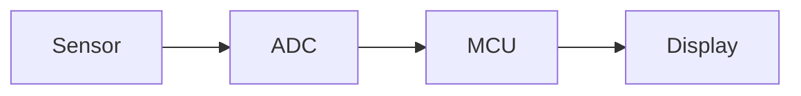

# Setting up a PaperNotes library

This file is written for an AI assistant (Claude, ChatGPT, anything). Give it this file together with your notes, slides, or a description of your course, and ask it to turn them into a PaperNotes library. It explains the folder layout, the file names, and the Markdown that PaperNotes understands, so the result works straight away.

A person can read it too (｀・ω・´)

---

## Instructions for the assistant

You are preparing a **library** for PaperNotes, a study app. A library is one ordinary folder of files. PaperNotes shows the folder as a tree, renders Markdown notes, opens PDFs, slides and images, and adds study tools on top (done marks, tags, flashcards, reminders). It never changes files on its own, so everything you produce is plain files the student keeps.

Your job:

1. Build the folder structure below, with one folder per module or subject.
2. Write the notes as Markdown (`.md`) files in the format described here.
3. Put existing material (PDFs, slides, past papers) where it belongs, without converting it.
4. Write `info.md`, and `timetable.csv` if the student gave you a timetable.
5. Check your work against the checklist at the end.

Ask the student for anything you need and don't have: their name, school, course, which modules, and when week 1 of the semester starts. Never invent facts about their course, exams or deadlines. If you're unsure, leave a clearly marked gap (`> [!warn|Check this]`) instead of guessing.

---

## 1. Folder structure

```
My Library/
├── info.md                      who the student is (hidden from the tree)
├── timetable.csv                their classes (hidden from the tree)
├── Time-Table.png               optional picture of the timetable
├── 00 Start here.md             optional: how this library is organised
├── 01 Study/                    notes to learn from, one folder per module
│   ├── ET1010 Microcontrollers/
│   │   ├── 00 About this unit.md
│   │   ├── 01 Introduction.md
│   │   ├── 02 GPIO and LEDs.md
│   │   ├── 03 ADC.md
│   │   └── img/
│   │       └── adc-block-diagram.png
│   └── MS_SAE Statistics/
│       └── ...
├── 02 Exams/                    past papers, practice tests, answers, formats
│   └── ET1010 Microcontrollers/
│       ├── 2024 S1 MST.pdf
│       ├── 2024 S1 MST solutions.pdf
│       └── Test format.md
├── 03 School/                   material as the school gave it (slides, labs, PDFs)
│   └── ET1010 Microcontrollers/
│       ├── 01 Lecture slides/
│       └── 02 Lab sheets/
└── 04 My notes/                 the student's own writing
    └── Inbox.md
```

The top-level names are a convention, not a rule; any folders work. This layout works well because study notes, exam material and raw school files stay apart, and each has the same module folders inside.

**Names and order**

- Start names with a number to fix the order: `01 Introduction.md`, `02 GPIO and LEDs.md`. PaperNotes sorts numerically (2 comes before 10) and hides the number when it shows the title, so `03 ADC.md` appears as **ADC**.
- A note's title is, in order: `title:` in its front matter, else its first `# Heading`, else the file name.
- Use only characters Windows allows in file names: no `\ / : * ? " < > |`.
- Keep module codes in folder names (`ET1010 Microcontrollers`); students search by them.
- Put a note's images in an `img/` folder next to it and link them relatively.

**What shows up**

- Notes: `.md`, `.markdown`, `.mdx`
- Also opened in the app: PDFs, images, videos, audio, `.html` pages, Jupyter notebooks, CSV tables, Office files (Word, PowerPoint, Excel), `.url` links, code and text files.
- Hidden automatically: files and folders starting with `.`, plus `.git`, `node_modules`, `.obsidian`, `.vscode`, `dist`, and `info.md` and `timetable.csv` at the top of the library.
- To hide anything else, add a `.notesignore` file with one pattern per line (`*.tmp`, `drafts/**`, `Old stuff`).

**Progress**

Every note, PDF, Office file and notebook counts towards a folder's progress when the student marks it done. Files named `00 About this unit.md` don't count, so use that name for a module's overview.

---

## 2. info.md

At the top of the library. The front matter is read by the app; the "Context for Claude" section is handed to Claude when the student studies with it. Every field is optional.

```markdown
---
name: Alex Tan
school: Singapore Polytechnic
course: Computer Engineering
year: 2
semester: 2
semesterStart: 2026-10-19
vacation: 9-11
exams: 19-20
weeks: 20
timetable: timetable.csv
---

# About me

## Context for Claude

How I like things explained: short, concrete, a worked example first.
What I find hard: interrupts, probability.
My modules this semester: ET1010 Microcontrollers, MS_SAE Statistics.
Rules for Claude: quiz me before moving on, no emojis.
```

- `semesterStart` is the Monday of week 1, as `YYYY-MM-DD`. The app shows **Wk 1**, **Wk 2** and so on from it.
- `vacation` and `exams` are week numbers (`9-11`, or `9, 10, 11`) for schools that keep counting weeks through the holidays. `weeks` is the last week of the semester.

## 3. timetable.csv

At the top of the library. One class per line; the header row is optional; days can be `Mon`, `Monday` or `1`.

```csv
Day,Start,End,Module,Type,Room,Notes
Mon,09:00,11:00,ET1010 Microcontrollers,Lecture,T1234,
Wed,14:00,16:00,ET1010 Microcontrollers,Lab,Lab 3,Bring the board
Thu,10:00,12:00,MS_SAE Statistics,Tutorial,T2201,
```

Times are 24-hour `HH:MM`. Today's classes appear on the home screen.

---

## 4. Writing notes

Standard Markdown (CommonMark plus tables, task lists and footnotes) with a few extras. Headings build the outline on the right, so give every note a clear `#` title and `##` sections.

### Front matter (optional)

```markdown
---
title: Analogue to digital conversion
tags: [et1010, adc, chapter-4]
---
```

### Maths and chemistry

- Inline `$V = IR$`, display `$$ V_{out} = \frac{R_2}{R_1 + R_2} V_{in} $$` (KaTeX).
- Chemistry with mhchem: `$\ce{2H2 + O2 -> 2H2O}$`, units with `$\pu{9.81 m/s^2}$`.

### Diagrams

Two easy kinds that need no diagram language, plus Mermaid for anything else. Prefer the easy ones: they are quicker to write and harder to get wrong.

**Trees** (mind maps, hierarchies, breakdowns): an indented outline, one box per line. Bullets are fine. ` ```tree ` grows to the right, ` ```tree down ` grows downwards. Clicking a box folds its branch.

````markdown
```tree
Microcontroller
  Inputs
    Buttons
    Sensors
  Processing
    ADC
    Timers
  Outputs
    LEDs
    Motors
```
````

**Flowcharts**: one step per line. A line indented under another gets an arrow from it. `A -> B` draws an arrow on one line. `|yes|` before a step labels the arrow into it. Writing the same text twice means the same box, which is how branches meet again or loop back. ` ```flow right ` lays it out sideways.

````markdown
```flow
(Start)
  Read the sensor
    Is it above the limit?
      |yes| Turn the fan on -> (Done)
      |no| Wait one second -> Read the sensor
```
````

Shapes: a step ending in `?` is a decision diamond, `(Start)` is a round start or end, `((Circle))`, `[(Database)]` and `[/Input or output/]` are the others, and a step that is a `[[note link]]` opens that note when clicked. If something is wrong, the note shows the line number.

Anything else (sequence diagrams, state machines, timing, Gantt charts): Mermaid.

````markdown

````

### Code

Fenced blocks with a language get highlighting: ` ```c `, ` ```python `, ` ```js `. Two kinds run inside the note, in a sandbox:

- ` ```js run ` and ` ```html run ` show a Run button.
- ` ```html live ` runs as soon as the note opens (for small interactive demos).

### Callout boxes

A quote whose first line is `[!type]` becomes a coloured box with an icon, the same syntax Obsidian uses. Text after the type is the box's title. A `-` after the type makes it start folded (click to open, good for answers to self-test questions), `+` makes it foldable but open. `[!type|Your own title]` also works.

```markdown
> [!key]
> The core idea of the section. If someone only reads the key boxes, they've read the module.

> [!exam] Asked every year
> What gets tested, and how.

> [!question]- What is the resolution of a 10-bit ADC at 5 V?
> 5 V / 1024, about 4.9 mV per step.
```

| Type | Use it for |
|---|---|
| `key` | the core idea of a section |
| `exam` | what gets tested and how |
| `trap` | mistakes that lose marks |
| `mem` | memory hooks and mnemonics |
| `ex` | worked examples |
| `why` | the reason behind something |
| `tip`, `note`, `warn`, `code` | the obvious |
| `lol` | a brain break: a joke, a silly analogy |

Obsidian's types work too: `info`, `todo`, `abstract` (`summary`, `tldr`), `success` (`done`), `question` (`faq`, `help`), `warning` (`caution`), `failure`, `danger` (`error`), `bug`, `example`, `quote` (`cite`).

### Emphasis and labels

- `==highlighted text==`, or in another colour: `==g:green==` `==b:blue==` `==r:red==` `==p:purple==` `==o:orange==`
- Coloured words: `{r:red}` `{o:orange}` `{g:green}` `{b:blue}` `{p:purple}`
- `#tags` anywhere in the text (they need a letter: `#exam-prep`, not `#2024`); clicking one searches for it
- `%% a comment %%` is hidden when reading; a line starting with `%%` hides everything up to the next `%%`
- Tasks: `- [ ]` and `- [x]` (the student can tick them while reading), plus `- [/]` doing, `- [-]` cancelled, `- [>]` moved on, `- [?]` question, `- [!]` important, `- [*]` starred
- Footnotes: `[^1]` with `[^1]: the note` below, or inline `^[like this]`
- A file name on a code block: ` ```c title="blink.c" `
- A kaomoji that should never be mangled by Markdown: `{k:(╯°□°)╯︵ ┻━┻}`
- Where something came from: `[[OFF]]` official (slides, answers), `[[ME]]` the student's own working, `[[HY]]` high-yield, `[[NEW]]` new.

### Links and images

- Link to another note by its file name, with or without the number: `[[03 ADC]]` or `[[ADC]]`; with a label `[[03 ADC|the ADC chapter]]`, to a section `[[03 ADC#Resolution]]`, to a section of the same note `[[#Resolution]]`.
- Name a paragraph or list item by ending it with ` ^some-name`, then link to exactly that: `[[03 ADC#^some-name]]`.
- Ordinary links work too: `[ADC](03%20ADC.md)`, `[datasheet](https://...)`.
- Images, with an optional width: ``. Use `"80%!"` for a big one.
- Embed (show inside this note) another note, one section of it, or one named block: `![[03 ADC]]`, `![[03 ADC#Resolution]]`, `![[03 ADC#^some-name]]`. Files too: `![[block-diagram.png|400]]` (400 px wide), `![[lecture.mp4]]`, `![[slides.pdf#page=3]]`.
- Hovering a link to another note shows a preview, and each note lists the notes that link to it at the bottom, so linking related notes is worth it.

### Flashcards

Write question and answer pairs anywhere in a note. The student imports them into spaced-repetition flashcards with one click (the Cards tab in the toolkit, "Import Q:/A: cards from this note"):

```markdown
Q: What does a 12-bit ADC's resolution mean for a 3.3 V reference?
A: 3.3 V / 4096 steps, about 0.8 mV per step.

Q: Why debounce a push button?
A: The contacts bounce for a few milliseconds, so one press reads as several.
```

Blank lines separate cards. Answers can use Markdown and maths.

---

## 5. An example note

````markdown
---
title: Analogue to digital conversion
tags: [et1010, chapter-4]
---

# Analogue to digital conversion

> [!key]
> An ADC turns a voltage into a number: $N = \frac{V_{in}}{V_{ref}} (2^n - 1)$.

## Resolution

A 12-bit ADC has $2^{12} = 4096$ steps. With $V_{ref} = 3.3\,\text{V}$, one step is about ==0.8 mV==. [[OFF]]

> [!exam]
> Expect "find the digital output for 1.65 V" (answer: about 2048). Show the formula, then the number.

> [!trap]
> $2^n - 1$, not $2^n$: the top code is 4095.

## Reading it in Mbed

```cpp
AnalogIn pot(PA_0);
float v = pot.read() * 3.3f;   // read() gives 0.0 to 1.0
```

> [!mem]
> "Ref over steps": the size of one step is $V_{ref} / 2^n$.

> [!lol]
> The ADC is just a very fast person with a ruler and no opinions. {k:(￣▽￣)ノ}

Q: Digital output of a 12-bit ADC (3.3 V ref) for 1.65 V?
A: About 2048 (half of 4095, rounded).

See also [[05 Timers]].
````

---

## 6. Checklist before you hand it over

- [ ] One folder per module inside `01 Study`, `02 Exams` and `03 School` (or whatever structure the student asked for), with the module code in each name.
- [ ] Files numbered for order (`01 `, `02 `), Windows-safe names, `00 About this unit.md` for overviews.
- [ ] Every note has a `#` title and `##` sections; maths in `$...$`; diagrams in ` ```tree `, ` ```flow ` or ` ```mermaid `.
- [ ] Callouts use only the types listed above.
- [ ] Images are in `img/` next to the note and linked relatively.
- [ ] `[[wikilinks]]` point at notes that exist (by file name, without `.md`).
- [ ] `info.md` at the top with what the student told you, and nothing made up. `semesterStart` is a Monday.
- [ ] `timetable.csv` uses 24-hour times and the header `Day,Start,End,Module,Type,Room,Notes`.
- [ ] Existing PDFs and slides kept as they are, just filed in the right folders.
- [ ] Anything uncertain is marked with `> [!warn|Check this]`, not guessed.

Then the student opens PaperNotes, picks the folder, and starts studying ヽ(・∀・)ﾉ
